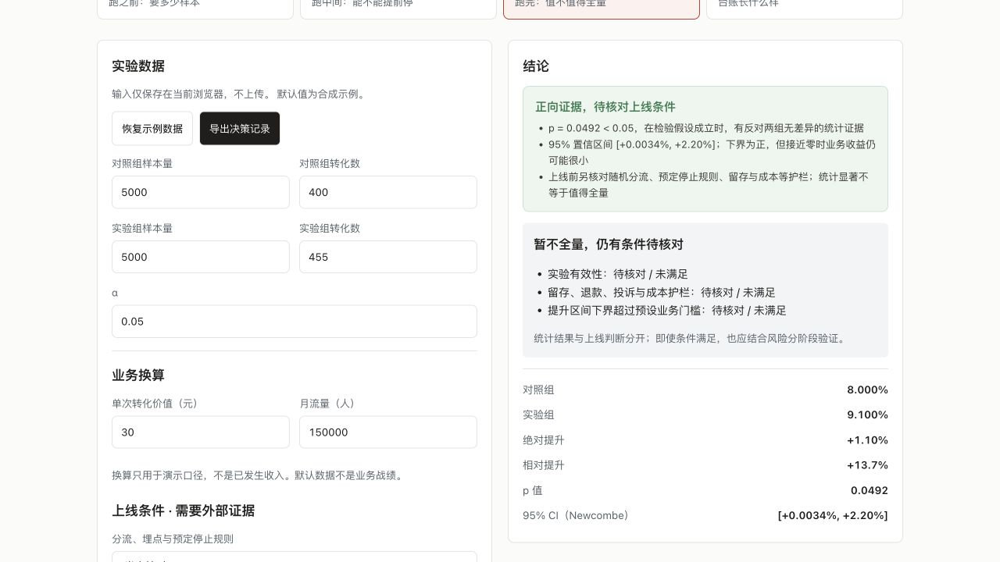

# Growth Experiment Lab

[中文](README.md) · [Project index](https://github.com/AndyZhang666666/AndyZhang666666/blob/main/PROJECTS.en.md) · [Live demo](https://andyzhang666666.github.io/growth-experiment-lab/)

What must be checked after significance before deciding to roll out?



<!-- github-evidence-20261031 -->

[Design decisions](docs/DECISIONS.md) · [Validation records](docs/VALIDATION.md) · [PR core checks](https://github.com/AndyZhang666666/growth-experiment-lab/actions/workflows/checks.yml)

## From statistical evidence to a rollout decision

- Define the plan before reading results; do not change stopping rules to suit a p-value.
- Separate statistical evidence, minimum practical effect and external guardrails.
- A person records the rollout decision; changed inputs invalidate old confirmations.

## Walkthrough

1. Plan baseline, minimum effect, traffic and time budget.
2. Use the peeking simulator to compare checking strategies.
3. Enter conversion counts, inspect business thresholds and guardrails, and export a decision.

## Run mode and limits

Local statistical tools with synthetic cases and seeded simulations. Revenue is a conditional scenario. The OBF-like approximation is not calibrated to the input alpha and is not a production sequential design.

The examples support product reasoning, not measured business outcomes. Inspect population definitions, costs and uncalibrated assumptions before applying the result to a real experiment.

## Develop locally

```sh
npm ci
npm run dev
```

Open `http://localhost:3000/growth-experiment-lab/`. The repository base path is part of the URL.

## Reproduce the core checks

```sh
npm test
npm run check:release
npm run verify:readme
npm run build
```

These commands are provided for reproduction; this documentation update did not run a new model benchmark.

## Documentation

- [Product scope](docs/PRD.md)
- [Statistical assumptions](docs/ASSUMPTIONS.md)
- [Design decisions](docs/DECISIONS.md)
- [Validation records](docs/VALIDATION.md)
- [Implementation details and original records, Chinese](README.md)

Use the repository’s existing licence and notices. This update does not change usage rights.

[PR core checks](https://github.com/AndyZhang666666/growth-experiment-lab/actions/workflows/checks.yml) reuse the deterministic checks and static build. Only the main-branch Pages workflow deploys.
